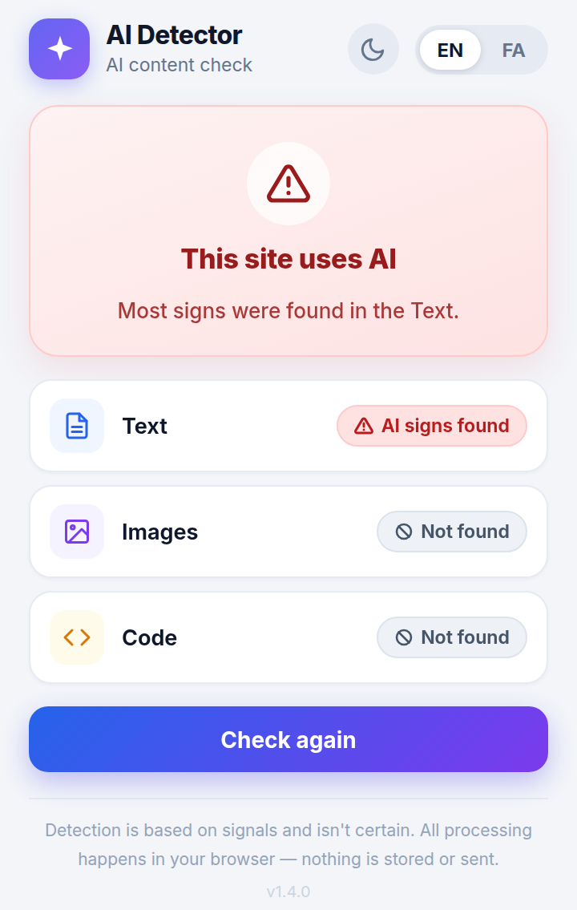
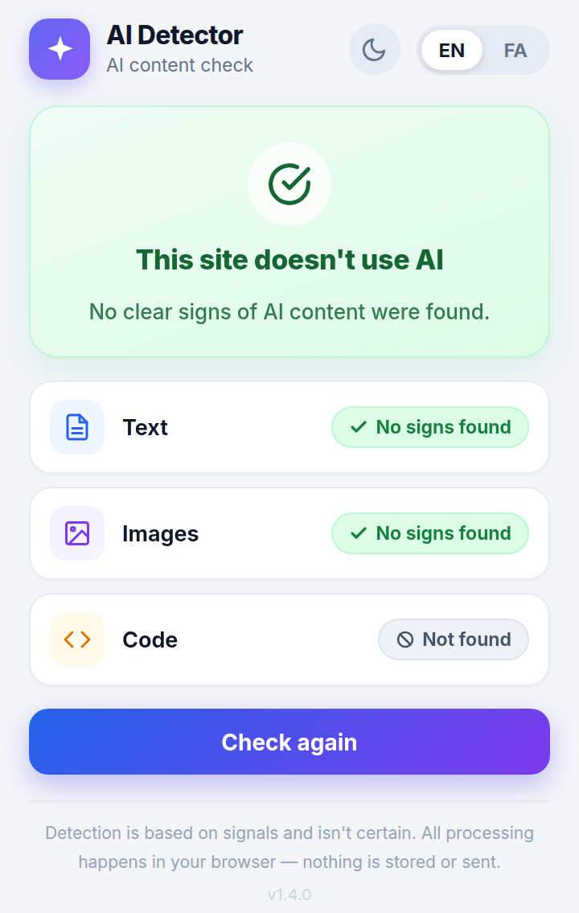

# AI Detector


A Chrome extension that answers one question about the page you're on, in one
sentence: **does this site use AI content?**

The popup shows only the verdict — **"This site uses AI"** (red) or **"This
site doesn't use AI"** (green). No score, no percentage, no bands. English UI
by default, with a one-tap switch to a full Persian (RTL) interface and a
dark mode toggle. Everything runs locally in your browser: no network calls,
no model, no data collected, nothing leaves the page.

## Screenshots

<p> </p>

## What it checks

| Category | How it works |
|---|---|
| **Text** | Sentence-length uniformity, stock AI phrases, low word variety, repetitive sentence starters. Unicode-aware tokenization, so Persian/Arabic text is analyzed instead of vanishing. |
| **Images** | Provenance and metadata signals only: C2PA / Content Credentials markers, known generator fingerprints in URLs and alt text (Midjourney, DALL·E, Stable Diffusion, Firefly, …), explicit AI data attributes. **No pixel-level detection.** |
| **Code** | Displayed `<pre>`/`<code>` blocks **and** the page's own inline scripts. Signals include comment density, instructional comment phrasing, leftover chat artifacts, structural uniformity, and generic identifier density. Always labeled low-confidence. |

Categories that aren't on the page say so explicitly ("Not found") instead of
showing a blank.

## How the verdict is decided

Each category gets an internal 0–100 score, combined into one overall score
(text 50%, images 25%, code 25%, redistributed over categories that are
present). One threshold decides the verdict: overall ≥ 35 → red, below →
green. The threshold is a named constant (`AI_THRESHOLD`) in `content.js`.
Scores are never shown in the popup — they only make the decision.

## Install

**Chrome Web Store:** coming soon.

**Load unpacked (works right now):**

1. Download this repository (Code → Download ZIP) and unzip it.
2. Get the bundled fonts (optional but recommended for the exact typography):
   `bash scripts/fetch-fonts.sh`
   Without them the popup falls back to system fonts.
3. Open `chrome://extensions`, enable **Developer mode**.
4. Click **Load unpacked** and select the unzipped folder.
5. Open any page and click the extension icon — it checks automatically.

## Honest limits

- **A binary verdict hides uncertainty.** A borderline page gets a definitive
  green or red even when the signals are mixed. The threshold (35) is a draft,
  anchored on few samples: a real AI-slop page scored 39, human pages 5–22.
- **Image detection is metadata-only.** A stripped or re-uploaded AI image
  with no markers scores 0. True pixel-level detection needs a model and is a
  later phase.
- **Code detection is the weakest category** and is labeled low-confidence in
  the UI. Human code can look "AI" and AI code can look human.

## Privacy

Nothing is collected, stored, or sent anywhere. The content script reads the
visible page to score it, the popup renders the verdict, and the only thing
persisted is your own language/theme preference in `chrome.storage`.

Permissions: `activeTab`, `scripting`, `storage` (preferences only), and host
access so the content script can read pages you visit.

## Project structure

```text
manifest.json   MV3 manifest
content.js      page analysis + pure scorers (exposed as window.__aiDetector for testing)
popup.html      verdict UI markup + styles
popup.js        verdict UI logic, bilingual EN/FA, dark mode
fonts/          bundled Inter + Vazirmatn variable fonts (fetched via scripts/fetch-fonts.sh)
scripts/        setup helpers
```

## Roadmap

- [ ] Chrome Web Store listing
- [ ] More calibration samples (real human + real AI pages, EN + FA)
- [ ] Pixel-level image detection (model-based, later phase)
- [ ] Stronger code signals

## License

MIT — see [LICENSE](LICENSE). Fonts are SIL Open Font License (see
[fonts/README.md](fonts/README.md)).
